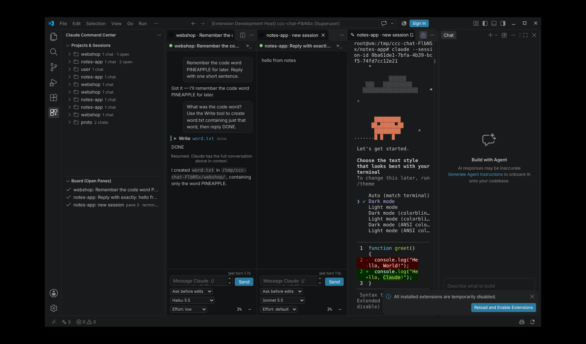

# Claude Command Center

One VS Code window, many Claude Code sessions. Each session runs in its own project folder
(projects are never merged). All of them sit side by side in a grid you can resize and rearrange.
It resumes your **existing** conversations with their full history.

Each pane is either a **chat view** (the default) or the **terminal (CLI)**. You can switch any pane with
the `>_` button or the swap icon in the Board view. To make the CLI the default, set `claudeCC.defaultView` to
`terminal` (the gear icon in the sidebar opens these settings).

Every chat pane has its own control bar under the prompt box, and its settings apply only to that chat:
permission mode, model, effort level, fast mode (models that support it), and a context meter. The `...` menu adds
rename, compact, context breakdown, MCP servers (enable, disable, reconnect), Remote Control on/off, switch to
terminal, and settings. These choices are saved with the board and restored.



It uses the normal `claude` CLI that you are already logged into, so usage comes out of your
Claude subscription. Nothing is sent anywhere else and nothing in the official Claude Code
extension is changed.

## How it works

| Need | How |
|---|---|
| Keep projects separate | Every pane runs `claude` with `cwd` set to that project's folder. No multi-root merge is needed. |
| Chat view | A webview that drives your local `claude` CLI in its headless stream-json mode, the same protocol the official extension and the Agent SDK use. It gives you message bubbles, a prompt box at the bottom, model and permission-mode pickers, a `/` menu (built-in commands, your custom commands and skills), `@` file mentions, pasted images, Allow / Always allow / Deny buttons for tool approvals, plan approval, Claude's multiple-choice questions, live streaming, Stop (Esc) and Shift+Tab to change mode. |
| Keep chat history | Claude Code (CLI **and** the official VS Code chat panel) saves every conversation in `~/.claude/projects/<folder>/<session-id>.jsonl`. The sidebar reads those files and opens a chat with `claude --resume <id>`, so you continue the same conversation. |
| See everything at once | The sessions are terminals in the editor area, laid out as a grid of editor groups (2 side by side, 2x2 quadrants, 3x2, 3x3...). You resize by dragging the borders between panes and rearrange by dragging tabs. Maximize one pane with `Ctrl+Alt+M`, then press it again to go back. |
| Know who needs you | The tree and status bar show each session as working (spinning), waiting (bell) or ready (check). A notification appears when a session in the background finishes or seems to be waiting for approval. |
| Survive restarts | The board (which sessions are open and in which pane) is saved for each workspace and reopened on startup with `--resume`. |

## Using it

1. Click the **Claude Command Center** icon in the activity bar.
2. **Projects & Sessions** lists every folder that already has Claude conversations. Pin the ones
   you use (pin icon) or add new folders (folder+ icon).
3. Click a conversation to open it on the board. It goes into the next empty pane, and the grid grows
   when every pane is full. You can also:
   - `+` on a project: start a new chat in that folder
   - `▷` on a project: resume its most recent chat
   - Right-click a chat: open it as a tab in the active pane, fork it, preview the transcript, copy its resume command
4. **Open Sessions as Grid...** (layout icon): pick several chats or new sessions at once and get one pane for each.
5. In the **Board** view: change the layout, **Tidy** (one session per pane), **Send prompt to several sessions**,
   restore the last board, close all.

Shortcuts: `Ctrl+Alt+K` jump to a session, `Ctrl+Alt+M` maximize or restore the current pane, `Ctrl+Alt+B` send a prompt to several sessions.

Tip: if you also want each project's files in the Explorer, right-click a project and choose
**Add Folder to Workspace**, then save the workspace (File > Save Workspace As). Folders in a
multi-root workspace stay separate, and the board is saved for that workspace.

## Chat view vs terminal view

| | Chat view | Terminal view |
|---|---|---|
| Layout | Bubbles, prompt box at the bottom | Full Claude Code CLI UI |
| History on resume | Rendered from the transcript (the latest 600 items; Claude still has everything in context) | The CLI reprints it |
| Model, mode, effort, fast mode | Per-pane controls under the prompt box | `/model`, `/effort`, `/fast`, Shift+Tab |
| Context, MCP, Remote Control | Context meter and the `...` menu | `/context`, `/mcp`, `/remote-control` |
| Slash commands | `/` menu; commands that run as prompts work (`/compact`, custom commands, skills). Commands that open interactive pickers in the CLI (`/agents`, `/config`, `/resume`...) need the terminal view | All |
| Tool approvals | Buttons | Keyboard |
| Status for the board | Exact | Inferred from the transcript |

Both run the same agent with the same tools, settings, CLAUDE.md, MCP servers and hooks, and use your subscription login.

**Official Claude Code panel:** VS Code allows one official panel per window, and that panel always runs in the
window's *first* folder. So for that one project you can right-click a chat and choose **Open in Official Claude
Code Panel** to get Anthropic's own UI in the grid. Other projects use the chat view or terminal view.

## Bringing over chats from the official Claude Code chat panel

Those chats are stored in the same place, so they show up in the list automatically (with a chat
bubble icon). Opening one resumes it in the CLI with all of its history. **Close it in the chat panel
first.** Two programs writing to the same session at once can create a forked history.

## Settings

| Setting | Default | |
|---|---|---|
| `claudeCC.defaultView` | `chat` | `chat` or `terminal` for newly opened panes |
| `claudeCC.chatModel` | | Model for new chat panes (`opus`, `sonnet`, ...); empty = your default |
| `claudeCC.chatPermissionMode` | | Starting mode for chat panes (`default`, `acceptEdits`, `plan`, `auto`) |
| `claudeCC.chatEffort` | | Starting effort for chat panes (`low` ... `max`) |
| `claudeCC.claudeCommand` | `claude` | Path to the CLI if it is not on PATH |
| `claudeCC.extraArgs` | | e.g. `--model opus` or `--permission-mode acceptEdits` |
| `claudeCC.claudeDataDir` | `~/.claude` | Override where sessions are read from |
| `claudeCC.restoreOnStartup` | `true` | Reopen the board when VS Code starts |
| `claudeCC.notifyWhenDone` | `true` | Notifications for finished or waiting sessions |
| `claudeCC.showDiscoveredProjects` | `true` | List unpinned folders found in your history |
| `claudeCC.sessionsPerProject` | `15` | Chats shown per project before "show older" |
| `claudeCC.colorTerminals` | `true` | Each project gets its own tab color |

## Install

```
code --install-extension claude-command-center-0.3.0.vsix
```
Or in VS Code: Extensions view > `...` > **Install from VSIX...**

Requirements: VS Code 1.90 or later, and Claude Code CLI installed and logged in (`claude` works in a terminal).
On Windows the default PowerShell terminal works as is.

## Limits

- The chat view is our own UI on top of the CLI. Features that live only in the official panel (its session list,
  inline diff review in the editor) are not in the chat view. Commands that open interactive pickers in the CLI
  (`/agents`, `/config`...) need the terminal view.
- The terminal view's "waiting for approval" status is a guess: Claude is mid-turn and its transcript has not changed for 12 seconds.
  A long-running build looks the same.

## Development

No build step: plain JavaScript and no runtime dependencies. `media/marked.umd.js` (MIT) renders Markdown.

```
npm run package                       # builds the .vsix
xvfb-run -a node test/run.js      <dir with @vscode/test-electron> [shot.png] <VS Code binary>
xvfb-run -a node test/run-chat.js <dir with @vscode/test-electron> [shot.png] <VS Code binary>
```
- `test/run.js` starts a real VS Code with a fake `claude`. It checks discovery, resuming in the right folder,
  growing the grid, tidy, persistence, status detection and restore.
- `test/run-chat.js` uses the **real** CLI (a few cheap Haiku turns). It checks that a chat resumes a CLI conversation
  with its history and context, streaming, a tool approval round trip, a new chat in another project, separate
  model/effort per pane (checked against each CLI's applied settings), context meter, MCP list, chat/terminal
  switching in the same pane, and persistence of kinds and per-pane options.
