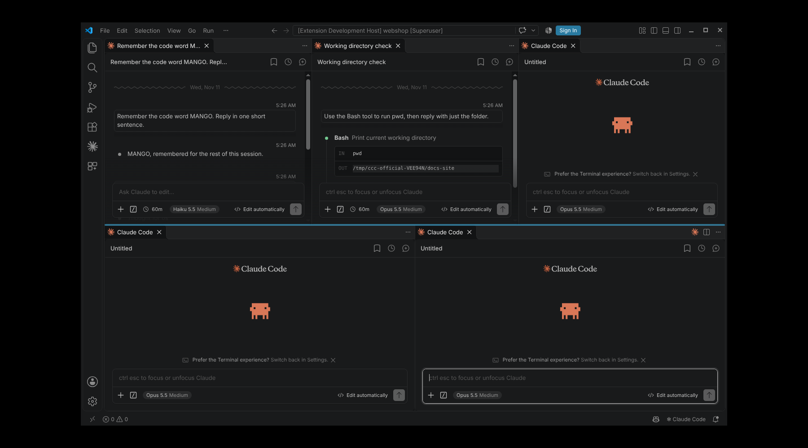

# Claude Command Center

One VS Code window, many **native** Claude Code sessions. Each session runs in its own project folder
(projects are never merged). All of them sit side by side in a grid of panes that you can resize and rearrange.
Your **existing** conversations resume with their full history.

This extension never draws Claude's interface itself. Every pane is Anthropic's own **official Claude Code chat
panel** (or, if you prefer, Claude Code's own CLI). The extension only finds your conversations, places them in
panes, and makes sure each one runs in its own project folder with its history. When Claude Code or its VS Code
extension updates, the panes pick up the update automatically.



## Official panel everywhere (how it works)

On its own, the official chat panel always runs in the window's **first folder** and only finds that folder's
chat history. With the **Official Panel Everywhere** setting (on by default) the extension removes that limit
using the official extension's own `claudeCode.claudeProcessWrapper` setting:

1. **A small launcher.** The official panel starts every Claude process through the program named in
   `claudeCode.claudeProcessWrapper`. Claude Command Center sets it to `claude-cc-wrapper`, a tiny program
   ([source](wrapper/main.go)) that runs the **same** Claude binary with the **same** arguments, only in the right
   folder: for a resumed chat, the folder recorded in that chat's history; for a new chat, the project you started
   it from. Everything else (sign-in checks, first-folder chats) runs unchanged.
2. **History links.** So the official panel can find a chat from another project, the extension adds a *hard link*
   to that chat's history file in the first folder's history folder. A hard link is a second name for the same file,
   not a copy: Claude keeps writing to the original, and the link always shows the same content.

Turning the setting off restores `claudeCode.claudeProcessWrapper` and removes every link the extension made
(your original history files are never changed). If you already use your own process wrapper, the extension leaves
it alone and other projects open in the Claude Code CLI instead.

Things to know:
- Chats linked this way also appear in the first folder's chat list in the official panel, and in `claude --resume`
  run from the first folder in a plain terminal. Resuming one from a plain terminal there would run it in the first
  folder; open it from Claude Command Center (or `cd` to its project first).
- The official panel's `@`-file search and "current file" attachment work from the window's first folder; add the
  other projects to the workspace (right-click a project, **Add Folder to Workspace**) to search their files too.
  Claude's own tools, edits, CLAUDE.md and settings use the chat's project folder.

## How it works

| Need | How |
|---|---|
| Keep projects separate | Each CLI pane starts `claude` with its working folder set to that project. No multi-root merge is needed. |
| Keep chat history | Claude Code (CLI **and** the official chat panel) saves every conversation in `~/.claude/projects/<folder>/<session-id>.jsonl`. The sidebar reads those files (read only) and lists every conversation by project. |
| See everything at once | Panes are editor groups laid out as a grid (2 side by side, 2x2 quadrants, 3x2, 3x3...). Drag the borders between panes to resize them and drag tabs to rearrange. `Ctrl+Alt+M` maximizes a pane; press it again to go back. |
| Know who needs you | CLI panes show working / waiting / ready in the Board view and status bar. A notification appears when a background session finishes or seems to wait for approval. (Official panels have their own indicators.) |
| Survive restarts | The board's CLI panes are saved per workspace and reopened with `--resume`. Official chat tabs are restored by the official extension. |

## Using it

1. Click the **Claude Command Center** icon in the activity bar.
2. **Projects & Sessions** lists every folder that has Claude conversations. Pin the ones you use (pin icon) or add folders (folder+ icon).
3. Click a conversation to open it on the board. It goes into the next empty pane, and the grid grows when every pane is full. You can also:
   - `+` on a project: start a new chat in that folder
   - `▷` on a project: resume its most recent chat
   - Right-click a chat: open it in the CLI, open it as a tab in the current pane, fork it, preview the transcript, or copy its resume command
4. **Open Sessions as Grid...** (layout icon): pick several chats or new sessions at once, one pane each.
5. **Board** view: change the layout, **Tidy** (one tab per pane), **Send prompt to several CLI sessions**, restore the last board, close all.

Shortcuts: `Ctrl+Alt+K` jump to a session, `Ctrl+Alt+M` maximize or restore the current pane, `Ctrl+Alt+B` send a prompt to several sessions.

Tip: open the project you work in most as the window's first folder; its chats then get the official chat panel.
To also see the other projects' files in the Explorer, right-click a project, choose **Add Folder to Workspace**, and save the
workspace (File > Save Workspace As). Folders in a multi-root workspace stay separate.

**Do not keep the same conversation open in two places at once** (for example in a CLI pane and in the official
panel). Two programs writing to one conversation can split its history into two branches.

## Settings

| Setting | Default | |
|---|---|---|
| `claudeCC.officialPanelEverywhere` | `true` | Let the official chat panel host chats of every project (see above) |
| `claudeCC.preferOfficialPanel` | `true` | Open chats in the official chat panel when it can host them (otherwise in the CLI) |
| `claudeCC.claudeCommand` | `claude` | Path to the CLI if it is not on PATH |
| `claudeCC.extraArgs` | | Extra CLI arguments, e.g. `--model opus` |
| `claudeCC.claudeDataDir` | `~/.claude` | Override where conversations are read from |
| `claudeCC.restoreOnStartup` | `true` | Reopen the board when VS Code starts |
| `claudeCC.notifyWhenDone` | `true` | Notifications for finished or waiting CLI sessions |
| `claudeCC.showDiscoveredProjects` | `true` | List unpinned folders found in your history |
| `claudeCC.sessionsPerProject` | `15` | Chats shown per project before "show older" |
| `claudeCC.colorTerminals` | `true` | Each project gets its own tab color |

## Install

```
code --install-extension claude-command-center-0.5.0.vsix
```
Or in VS Code: Extensions view > `...` > **Install from VSIX...**

Requirements: VS Code 1.90 or later and the official Claude Code extension (for the chat panels). The Claude Code
CLI (`claude` in a terminal) is needed only for CLI panes. The launcher ships for Windows, macOS and Linux (x64 and arm64).

## Development

Plain JavaScript, no runtime dependencies. The launcher is Go (`wrapper/`), prebuilt into `bin/`.

```
npm run build-wrapper   # rebuilds bin/<platform>/claude-cc-wrapper (needs Go)
npm run package         # builds the .vsix
xvfb-run -a node test/run.js <dir with @vscode/test-electron> [shot.png] <VS Code binary>
xvfb-run -a -s "-screen 0 1600x1000x24" node test/run-official.js <dir with @vscode/test-electron> <VS Code binary> <extensions dir with anthropic.claude-code> [shot.png]
```
`test/run-official.js` drives the **real** official extension and the real `claude` CLI (a few cheap Haiku turns,
xdotool to type into the panel). It checks: the setting is applied; a chat from another project opens in the official
panel with its history and context and runs in its own folder; a new chat started for another project runs there and
is linked; first-folder chats are unchanged; several new chats opened back to back each get their own folder; a closed
chat reopens in its folder; and turning the feature off restores the setting and removes only the links.
`test/run.js` starts a real VS Code with a fake `claude`. It checks:
- discovery of conversations and projects
- resuming each conversation in its own folder
- growing the grid, tidy, persistence and restore
- status detection
- routing: chats of the first folder go to the official panel's own command, with the session id and target pane;
  other projects go to the CLI; "Open in Claude Code CLI" bypasses the official panel
